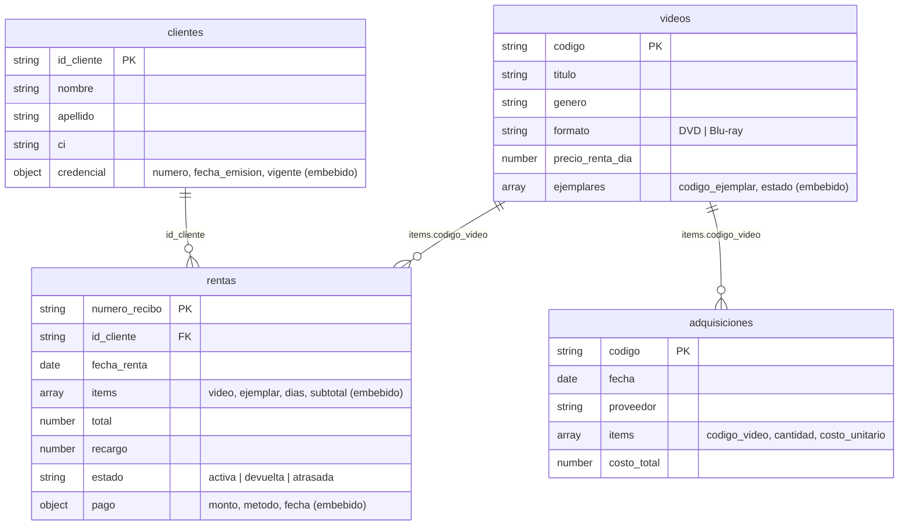

# 🎬 Sistema de Renta de Videos — MongoDB

**Materia:** FBD-111 Fundamentos de Bases de Datos · **Evaluación Continua – Hito 3** · Grupo 2

**Integrantes:**
- Ronald Cruz Chino
- Denilson Davis Machaca Flores
- Daniel Wilfredo Pomarez Huaranca

Implementación completa en **MongoDB** del problema visto en clase *«Renta de videos»*: creación de la base de datos con validaciones e índices, carga de datos de ejemplo y consultas (básicas, de administración y de contabilidad).

---

## 1. Del diagrama de contexto a las colecciones

El punto de partida es el **Diagrama de contexto (Nivel 0)** del sistema, disponible en [`docs/DFD_nivel0_renta_videos.drawio`](docs/DFD_nivel0_renta_videos.drawio). Sus entidades externas y flujos de datos se tradujeron así:

| Elemento del diagrama | Se implementa como |
|---|---|
| **Cliente** → *Registro nuevo cliente*, *Id_Cliente*; ← *Credencial de cliente* | Colección `clientes` (la credencial va embebida) |
| **Sistema de Adquisición de Video** → *Información de video* | Colección `adquisiciones` + colección `videos` |
| *Información de estado del video*, *Artículo de video* | Arreglo embebido `ejemplares[]` dentro de `videos` (estado de cada copia física) |
| *Pago*, ← *Recibo de renta de video* | Colección `rentas` (ítems y pago embebidos; `numero_recibo` es el recibo) |
| **Administración** ← *Informes para administración* | Consultas de agregación del bloque C del script `03` |
| **Contabilidad** ← *Extracto mensual*, *Extracto anual*, *Efectivo* | Consultas de agregación del bloque D del script `03` |

### Modelo de documentos



**Decisiones de diseño (embeber vs. referenciar):**
- **Embebido:** `credencial` dentro de `clientes`, `ejemplares` dentro de `videos`, y `items` + `pago` dentro de `rentas`. Siempre se leen juntos y no tienen sentido por separado.
- **Referenciado:** `rentas.id_cliente` apunta a `clientes` y `items.codigo_video` apunta a `videos`, porque clientes y videos viven y cambian independientemente de cada renta. Se unen con `$lookup` cuando hace falta.
- En cada renta se guarda una copia del **título, precio por día y nombre del cliente** (desnormalización controlada): el recibo debe conservar lo que se cobró aunque después cambie el precio.

---

## 2. Estructura del repositorio

```
renta-videos-mongodb/
├── README.md
├── scripts/
│   ├── 01_crear_bd.js          # base, colecciones, validadores $jsonSchema, índices
│   ├── 02_llenar_datos.js      # 6 clientes, 8 videos, 3 adquisiciones, 11 rentas
│   ├── 03_consultas.js         # 15 consultas (find, $lookup, agregaciones)
│   └── 04_operaciones.js       # alta de cliente, renta, devolución, cambios de estado
├── docs/
│   └── DFD_nivel0_renta_videos.drawio
└── capturas/                   # capturas de pantalla usadas en este README
```

---

## 3. Pasos para implementar la base de datos

### 3.1 Requisitos
- **MongoDB** 5.0 o superior: local (Community Server) o en la nube (**MongoDB Atlas**, clúster gratuito M0).
- **mongosh** (MongoDB Shell) instalado.
- **Git**.

### 3.2 Clonar el repositorio
```bash
git clone https://github.com/<usuario>/renta-videos-mongodb.git
cd renta-videos-mongodb
```

### 3.3 Conectarse y ejecutar los scripts

**Opción A — MongoDB local**
```bash
mongosh "mongodb://localhost:27017" --file scripts/01_crear_bd.js
mongosh "mongodb://localhost:27017" --file scripts/02_llenar_datos.js
mongosh "mongodb://localhost:27017" --file scripts/03_consultas.js
mongosh "mongodb://localhost:27017" --file scripts/04_operaciones.js   # opcional (modifica datos)
```

**Opción B — MongoDB Atlas**
```bash
mongosh "mongodb+srv://<usuario>:<contraseña>@<cluster>.mongodb.net/" --file scripts/01_crear_bd.js
# repetir con 02, 03 y 04
```
> ⚠️ No suba al repositorio la cadena de conexión ni la contraseña de Atlas.

**Opción C — desde una sesión interactiva de mongosh**
```js
load("scripts/01_crear_bd.js")
load("scripts/02_llenar_datos.js")
load("scripts/03_consultas.js")
```

### 3.4 Orden y reinicio
1. `01` crea la base `renta_videos` (se puede repetir; borra y recrea las colecciones).
2. `02` carga los datos (también se puede repetir: vacía las colecciones antes de insertar).
3. `03` solo lee; se puede ejecutar cuantas veces se quiera.
4. `04` modifica datos. Para volver al estado inicial, ejecutar de nuevo `02`.

### 3.5 Verificar
```js
use renta_videos
show collections
db.rentas.countDocuments()      // 11 (12 si ya se ejecutó el script 04)
```

---

## 4. Evidencias (capturas de pantalla)

> Reemplazar cada imagen con la captura real y revisar que el texto coincida con lo que se ve.

### 4.1 Conexión a MongoDB


Sesión de `mongosh` conectada al servidor (local o Atlas), con el comando `show dbs` antes de crear la base.

### 4.2 Creación de la base de datos, colecciones e índices


Salida de `01_crear_bd.js`: lista de las 4 colecciones (`clientes`, `videos`, `adquisiciones`, `rentas`) y los índices de cada una. Al final se ve la **prueba del validador**, donde un cliente incompleto es rechazado por el esquema `$jsonSchema`.

### 4.3 Inserción de datos


Salida de `02_llenar_datos.js`: cantidad de documentos por colección (6 / 8 / 3 / 11), rentas agrupadas por estado y un documento completo de `rentas` donde se aprecian los ítems y el pago embebidos.

### 4.4 Consultas básicas (C1 – C6)


Búsquedas con `find`: clientes con credencial vigente, videos por género, Blu-ray con precio máximo, ejemplares disponibles de un título, búsqueda de texto con el índice `text` y el historial de rentas de un cliente.

### 4.5 Recibo con datos del cliente (C7)


El recibo `REC-0010` unido con su cliente mediante `$lookup`, mostrando también la credencial.

### 4.6 Informes para administración (C8 – C12)


Resumen general, los 5 videos más rentados, clientes con mayor gasto, rentas atrasadas con días de atraso y recargo estimado, y estado del inventario por tipo de ejemplar.

### 4.7 Extractos para contabilidad (C13 – C15)


Extracto mensual de ingresos, extracto anual (ingresos por rentas frente a compras de videos) e ingresos por método de pago.

### 4.8 Operaciones del negocio


Salida de `04_operaciones.js`: registro de un nuevo cliente, nueva renta con su recibo, devolución con recargo por atraso, cambio de estado de un ejemplar y baja de una credencial.

### 4.9 Vista en MongoDB Compass / Atlas (opcional)


Las colecciones y un documento de `rentas` visualizados desde la interfaz gráfica.

---

## 5. Consultas incluidas (resumen)

| Id | Descripción | Técnica |
|----|-------------|---------|
| C1 | Clientes con credencial vigente | `find` + proyección + `sort` |
| C2 | Videos de un género | `find` |
| C3 | Blu-ray con precio ≤ 12 Bs | `find` con `$lte` |
| C4 | Ejemplares disponibles de un video | `aggregate` + `$filter` |
| C5 | Búsqueda de texto | índice `text` + `$meta: "textScore"` |
| C6 | Historial de rentas de un cliente | `find` + `sort` |
| C7 | Recibo con datos del cliente | `$lookup` + `$unwind` |
| C8 | Resumen general | `countDocuments` + `$unwind` |
| C9 | Videos más rentados | `$unwind` + `$group` + `$limit` |
| C10 | Clientes con mayor gasto | `$group` + `$lookup` |
| C11 | Rentas atrasadas y recargo | `$match` + `$addFields` + `$multiply` |
| C12 | Estado del inventario | `$unwind` + `$group` |
| C13 | Extracto mensual | `$dateToString` + `$group` |
| C14 | Extracto anual | `$year` + `$group` (rentas y adquisiciones) |
| C15 | Ingresos por método de pago | `$group` |

---

## 6. Tecnologías
MongoDB · mongosh · JavaScript · MongoDB Atlas / Compass (opcional)
